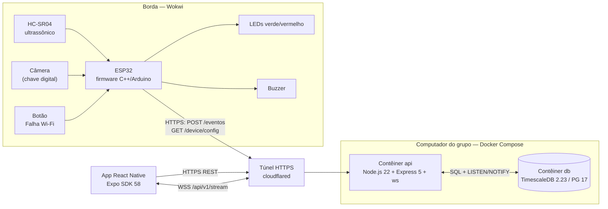
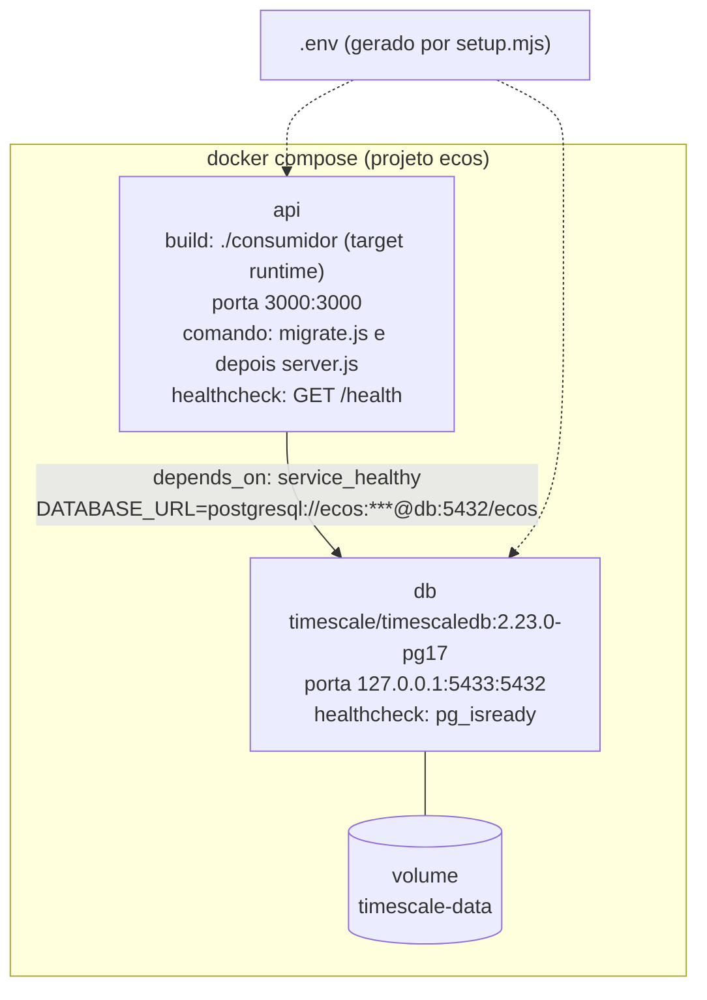
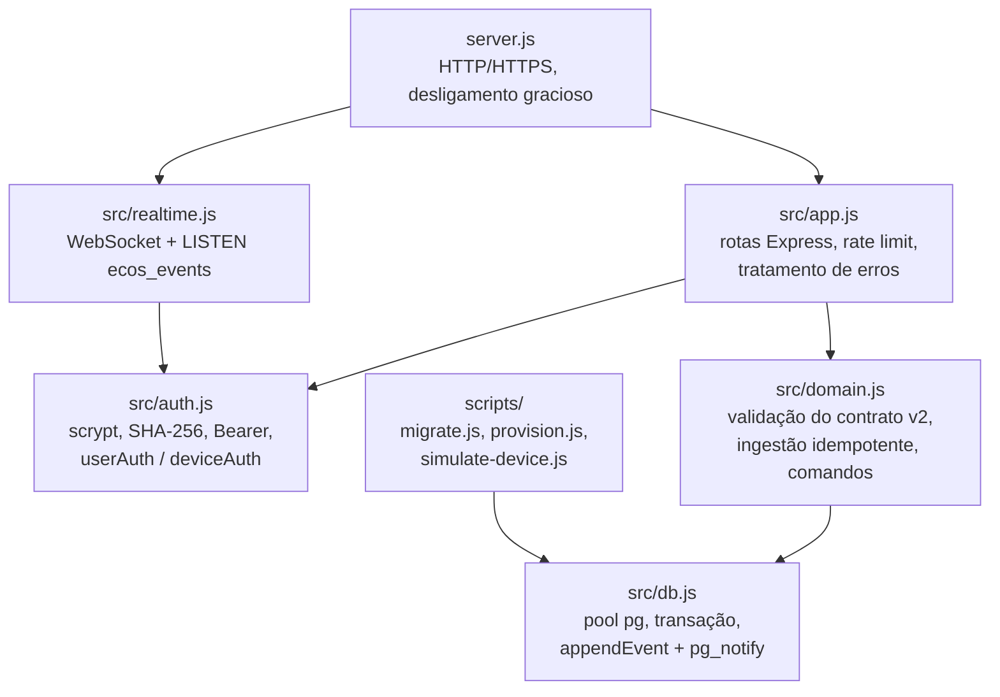
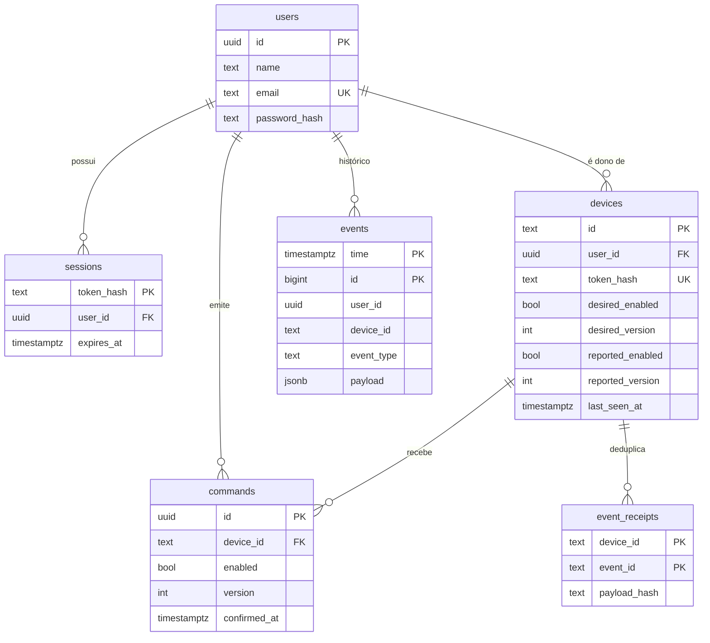
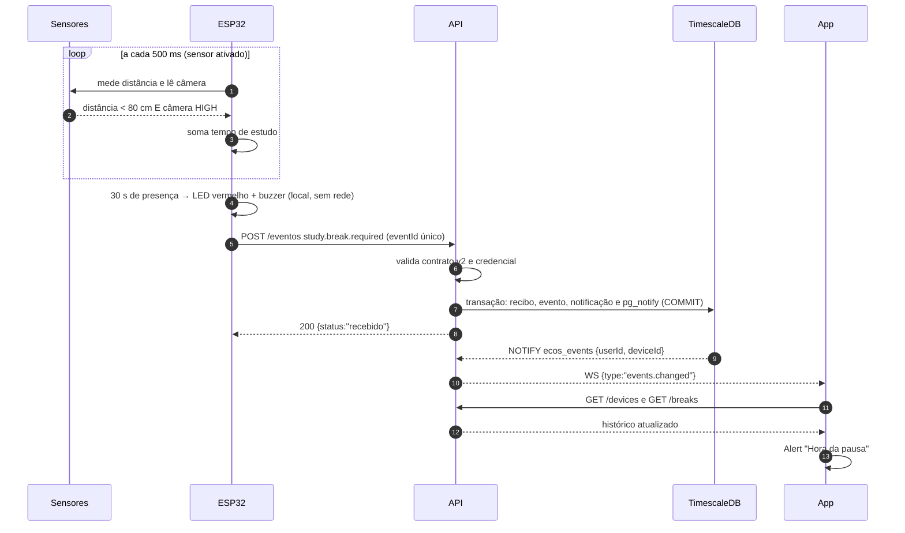
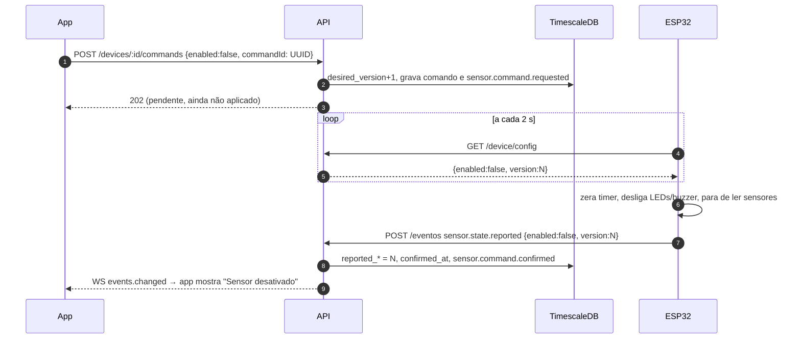

# Arquitetura do ECOS

**ECOS — Lembrete Inteligente de Lanche para Estudo em Casa**

Integrantes: Ana Liz Bomfim Gomes, Christopher Star Correa de Oliveira, Gustavo Alves Marçal, Mateus Silva de Sousa

Este documento descreve a arquitetura da versão atual do sistema (Marco 04): os componentes, as tecnologias usadas em cada um, como eles se comunicam, como os dados são persistidos e por que cada decisão foi tomada. Para executar o sistema, veja [instrucoes-execucao.md](../instrucoes-execucao.md). Para testes, veja [testes.md](testes.md).

---

## 1. Visão geral

O sistema detecta, por **fusão de dois sensores** (ultrassônico + câmera), que o estudante está sentado à mesa e, depois de um tempo contínuo de presença, recomenda uma pausa para lanche. O alerta é dado localmente (LED e buzzer) e também registrado em uma API, que mantém o histórico e avisa um aplicativo móvel em tempo real. Pelo app, o estudante também liga e desliga o sensor remotamente.

São quatro blocos:

| Bloco | Pasta | Papel |
|---|---|---|
| **Produtor (borda)** | [`produtor/`](../produtor) | ESP32 simulado no Wokwi: lê os sensores, conta o tempo de estudo, aciona LED/buzzer, publica eventos e consulta comandos |
| **API / middleware** | [`consumidor/`](../consumidor) | Node.js + Express + WebSocket: autentica, valida contratos, grava eventos, gera notificações e distribui comandos |
| **Banco temporal** | [`consumidor/migrations/`](../consumidor/migrations) | TimescaleDB (PostgreSQL 17): histórico de eventos em hypertable, contas, dispositivos e comandos |
| **Aplicativo móvel** | [`mobile/`](../mobile) | React Native + Expo: login, estado da mesa, ativar/desativar sensor e histórico de pausas |



---

## 2. Tecnologias utilizadas

### 2.1 Produtor — ESP32

| Tecnologia | Versão | Para que é usada |
|---|---|---|
| ESP32 DevKit C v4 | — | Microcontrolador com Wi-Fi; nó de borda e gateway |
| Framework Arduino (C++) | — | Linguagem e API de hardware do firmware ([`sketch.ino`](../produtor/sketch.ino)) |
| PlatformIO | plataforma `espressif32@6.9.0` | Compilação do firmware ([`platformio.ini`](../produtor/platformio.ini)) |
| Wokwi Simulator | — | Simulação do circuito ([`diagram.json`](../produtor/diagram.json), [`wokwi.toml`](../produtor/wokwi.toml)) |
| ArduinoJson | 7.4.2 | Montagem e leitura de JSON nos eventos e na configuração |
| `WiFiClientSecure` + `HTTPClient` | — | HTTPS com validação de certificado (CA fixada em `secrets.h`) |
| NTP (`configTime`) | — | Relógio correto, necessário para validar o certificado TLS |

**Circuito simulado** (pinos definidos no firmware):

| Componente | Pino | Função |
|---|---|---|
| HC-SR04 TRIG / ECHO | GPIO 4 / GPIO 2 | Distância até o estudante (presença se < 80 cm) |
| Chave deslizante "câmera" | GPIO 14 | Sinal digital de pessoa detectada (HIGH = presença) |
| Botão "Falha Wi-Fi" | GPIO 12 (pull-up) | Simula perda de conectividade |
| LED verde | GPIO 25 | Estudante presente, contando tempo |
| LED vermelho | GPIO 27 | Pausa recomendada |
| Buzzer | GPIO 19 | Bipe de 1,5 s no alerta |

### 2.2 API / middleware — `consumidor/`

| Tecnologia | Versão | Para que é usada |
|---|---|---|
| Node.js | 22 (imagem `node:22-alpine`) | Ambiente de execução |
| Express | 5.2 | Rotas REST, middlewares de autenticação e tratamento de erros |
| ws | 8.22 | Servidor WebSocket (`/api/v1/stream`) para avisos em tempo real |
| pg (node-postgres) | 8.16 | Pool de conexões, transações e `LISTEN/NOTIFY` |
| express-rate-limit | 8.2 | Limite de 20 tentativas de login por IP a cada 15 min |
| `node:crypto` | nativo | scrypt (senhas), SHA-256 (tokens), geração de tokens aleatórios |
| `node:test` | nativo | Executor de testes (sem dependências extras) |

### 2.3 Banco de dados

| Tecnologia | Versão | Para que é usada |
|---|---|---|
| PostgreSQL | 17 | Banco relacional: contas, sessões, dispositivos, comandos |
| TimescaleDB | 2.23 | Extensão de séries temporais: tabela `events` como **hypertable** particionada por tempo |

### 2.4 Aplicativo móvel — `mobile/`

| Tecnologia | Versão | Para que é usada |
|---|---|---|
| React Native | 0.88.1 | Interface nativa Android/iOS |
| React | 19.3 | Componentes e hooks (`useState`, `useEffect`, `useCallback`, `useRef`) |
| Expo | SDK 58 | Ferramentas de desenvolvimento, Metro, Expo Go / development build |
| TypeScript | 6.0 (modo `strict`) | Tipagem do app e do cliente da API |
| expo-secure-store | 58 | Guarda o token de sessão no armazenamento seguro do aparelho |
| expo-crypto | 58 | Gera o `commandId` (UUID) idempotente dos comandos |
| react-native-safe-area-context | 5.11 | Respeita entalhes e barras do sistema |
| WebSocket / fetch nativos | — | Tempo real e chamadas REST |

### 2.5 Infraestrutura e ferramentas

| Tecnologia | Para que é usada |
|---|---|
| **Docker** | Empacota a API em imagem multi-stage ([`consumidor/Dockerfile`](../consumidor/Dockerfile)): estágio `runtime` (produção, usuário sem privilégios `node`) e estágio `test` |
| **Docker Compose** | [`compose.yaml`](../compose.yaml) sobe `db` + `api` com healthchecks e volume persistente; [`compose.test.yaml`](../compose.test.yaml) sobe um banco descartável em `tmpfs` e roda a suíte de testes |
| **cloudflared** (Quick Tunnel) | Publica a API local em HTTPS para que o Wokwi e o celular a alcancem |
| **GitHub Actions** | [`.github/workflows/testes.yml`](../.github/workflows/testes.yml): testes da API, integração com Docker, testes/typecheck do app e compilação do firmware a cada push |
| `scripts/setup.mjs` | Gera `.env`, `mobile/.env` e `produtor/secrets.h` com segredos aleatórios |
| Render (histórico) | Hospedou o consumidor simples do Marco 02 |

---

## 3. Implantação (Docker)



Pontos principais:

- **A API só inicia depois que o banco está saudável** (`depends_on: condition: service_healthy`) e aplica as migrações antes de abrir a porta. As migrações são idempotentes e protegidas por `pg_advisory_xact_lock`, então várias instâncias podem subir ao mesmo tempo.
- **O banco só escuta em `127.0.0.1`**, ou seja, não fica exposto na rede. Dentro do Compose, a API o acessa por `db:5432`.
- **A imagem de produção** instala somente dependências de produção (`npm ci --omit=dev`), roda como usuário `node` e não copia testes nem arquivos `.env` (veja [`.dockerignore`](../consumidor/.dockerignore)).
- **O ambiente de testes** ([`compose.test.yaml`](../compose.test.yaml)) usa outro projeto (`ecos-test`), banco `ecos_test` em `tmpfs` e o estágio `test` da mesma imagem. Assim os testes nunca tocam o volume da aplicação.

---

## 4. Estrutura interna da API



| Módulo | Responsabilidade |
|---|---|
| [`server.js`](../consumidor/server.js) | Confere `DATABASE_URL`, cria servidor HTTP (ou HTTPS se houver certificado), acopla o WebSocket e trata `SIGTERM`/`SIGINT` |
| [`src/app.js`](../consumidor/src/app.js) | Rotas REST, `Cache-Control: no-store`, exigência de HTTPS em produção (426), limite de corpo de 4 KiB, paginação por cursor |
| [`src/auth.js`](../consumidor/src/auth.js) | Hash de senha (scrypt + salt), hash de token (SHA-256), extração de Bearer, middlewares de usuário e de dispositivo |
| [`src/domain.js`](../consumidor/src/domain.js) | Valida eventos (contrato v2), ingestão com deduplicação, confirmação de comandos, criação de comandos versionados |
| [`src/db.js`](../consumidor/src/db.js) | Pool, helper de transação e `appendEvent` (grava o evento e dispara `pg_notify` no mesmo COMMIT) |
| [`src/realtime.js`](../consumidor/src/realtime.js) | WebSocket autenticado na 1ª mensagem, avisos apenas ao dono, heartbeat e revalidação de sessão a cada 15 s |
| [`scripts/`](../consumidor/scripts) | Migração, cadastro administrativo de usuário/dispositivo e simulador HTTP do ESP32 |

### 4.1 Rotas

| Quem chama | Método e rota | Autenticação | Resultado |
|---|---|---|---|
| Qualquer um | `GET /health` | — | `{status:"ok"}` se o banco responde |
| App | `POST /api/v1/auth/login` | e-mail + senha | Token de sessão (7 dias) |
| App | `GET /api/v1/me` | sessão | Usuário logado |
| App | `POST /api/v1/auth/logout` | sessão | 204, sessão revogada |
| App | `GET /api/v1/devices` | sessão | Dispositivos do usuário, com estado desejado × relatado |
| App | `POST /api/v1/devices/:id/commands` | sessão | 202, comando versionado e pendente |
| App | `GET /api/v1/events` e `/api/v1/breaks` | sessão | Histórico paginado (filtros: dispositivo, tipo, período) |
| App | `WS /api/v1/stream` | sessão (1ª mensagem) | Avisos `events.changed` |
| ESP32 | `GET /api/v1/device/config` | token do dispositivo + `X-Device-Id` | Estado desejado `{enabled, version}` |
| ESP32 | `POST /api/v1/eventos` | token do dispositivo + `X-Device-Id` | 200 após persistir; `duplicate:true` em repetição |

O contrato completo está em [`contrato/mobile-api.md`](../contrato/mobile-api.md).

---

## 5. Modelo de dados



- **`events`** é uma hypertable do TimescaleDB particionada por `time`, com índices `(user_id, time DESC, id DESC)` e `(user_id, device_id, time DESC, id DESC)`, que atendem às consultas de histórico do app.
- **`event_receipts`** guarda a chave `(device_id, event_id)` e o hash do conteúdo. Ela garante a idempotência sem depender do particionamento por tempo: um reenvio idêntico responde `duplicate:true`, e o mesmo ID com outro conteúdo responde 409.
- **Senhas e tokens nunca são gravados em texto**: senhas usam scrypt com salt individual; tokens de sessão e de dispositivo, SHA-256.

### 5.1 Tipos de evento

| `eventType` | Quem gera | Significado |
|---|---|---|
| `study.break.required` | ESP32 | Pausa recomendada, com presença confirmada pelos dois sensores |
| `study.break.notification` | API | Notificação derivada do alerta, mostrada no app |
| `sensor.telemetry` | ESP32 | Amostra a cada 15 s: presença, distância e segundos de estudo |
| `sensor.state.reported` | ESP32 | Estado e versão de configuração realmente aplicados |
| `sensor.command.requested` | API | O usuário pediu para ativar/desativar |
| `sensor.command.confirmed` | API | O ESP32 confirmou a aplicação do comando |

O sensor só pode publicar os três primeiros tipos. Os demais retornam 403.

---

## 6. Fluxos principais

### 6.1 Alerta de pausa (borda → API → app)



A **decisão e a atuação ficam na borda**: o LED e o buzzer acionam mesmo sem internet. Se o envio falhar, o evento continua em memória e é reenviado com o **mesmo `eventId`**, e a API o deduplica.

### 6.2 Ativar/desativar sensor pelo app (API → borda)



O comando é **idempotente** (o app reutiliza o mesmo `commandId` ao repetir) e **versionado**: relatos antigos que chegam fora de ordem não sobrescrevem um estado mais novo. Como o ESP32 apenas *consulta* a API (pull), o fluxo funciona no Wokwi sem servidor de entrada no microcontrolador.

### 6.3 Sessão e tempo real

1. O app faz login e guarda o token no **SecureStore**.
2. Abre `wss://.../api/v1/stream` e envia `{type:"auth", token}` em até 5 s. Assim o token não vai na URL.
3. O servidor responde `ready` e só envia avisos de eventos daquele usuário.
4. O aviso é apenas um sinal; os dados sempre vêm da API REST. Se o WebSocket cair, o app reconecta com backoff exponencial (até 30 s) e consulta a API a cada 10 s, sem perder eventos.

---

## 7. Segurança

| Ameaça | Mitigação |
|---|---|
| Vazamento de senha/token do banco | scrypt + salt para senhas, SHA-256 para tokens, nada em texto |
| Força bruta no login | Rate limit (20/15 min) e mesmo custo de scrypt para usuário inexistente |
| Sensor se passando por outro usuário | `userId` é sempre obtido do cadastro do dispositivo; campos extras são descartados |
| Sensor publicando notificações ou comandos | Lista de tipos permitidos (403 para os demais) |
| App acessando dados de outro usuário | Todas as consultas filtram pelo usuário da sessão; parâmetros SQL (sem concatenação) |
| Credencial do sensor usada no app (e vice-versa) | Middlewares separados (`userAuth` × `deviceAuth`) |
| Tráfego interceptado | HTTPS/WSS obrigatório em produção (426); ESP32 valida o certificado com CA fixada e NTP |
| Corpos grandes / clientes lentos | Limite de 4 KiB em JSON e frames WS; desconexão de cliente com buffer cheio |
| Sessão roubada | Expiração em 7 dias, logout revoga, WebSocket revalida a cada 15 s |

---

## 8. Resiliência e falhas

| Falha | Comportamento |
|---|---|
| Wi-Fi do ESP32 cai (botão GPIO 12) | Alerta local continua; eventos ficam pendentes em RAM e são reenviados com o mesmo ID ao reconectar |
| API ou banco indisponível | ESP32 recebe erro e repete depois; a API só responde 200 após o COMMIT |
| Reenvio duplicado (ou concorrente) | `event_receipts` + lock na linha do dispositivo garantem um único registro |
| Comando enviado com ESP32 offline | Fica pendente e visível no app; o ESP32 aplica a versão mais recente ao voltar |
| WebSocket cai | App reconecta com backoff e consulta a API periodicamente |
| `LISTEN` do banco cai | API fecha os WebSockets (código 1012), o app ressincroniza e o listener tenta novamente a cada 2 s |
| Nova instância da API | Estado inteiro está no banco: histórico, comandos e deduplicação são recuperados |
| Fila de telemetria cresce | Backpressure: nova telemetria só é gerada depois que a anterior é persistida |

**Limites conhecidos:** pendências do ESP32 ficam em RAM e se perdem se ele reiniciar antes de enviar; não há push em segundo plano no app (o alerta aparece com o app aberto); não há retenção automática de eventos.

---

## 9. Decisões arquiteturais

| # | Decisão | Alternativa considerada | Motivo |
|---|---|---|---|
| D1 | Regra de pausa e atuação **na borda (ESP32)** | Decidir na nuvem | Latência mínima e funcionamento sem internet (Atividade 02) |
| D2 | **Fusão de sensores** (ultrassônico E câmera) | Um único sensor | Reduz falsos positivos de presença, o principal risco do projeto |
| D3 | **HTTPS request/response** do ESP32 | MQTT | Funciona no Wokwi sem broker, dá confirmação por status HTTP e aproveita o mesmo backend do app |
| D4 | **Contrato versionado** (`schemaVersion: 2`) | JSON livre | Produtor e consumidor evoluem com segurança; v1 é recusado explicitamente |
| D5 | **Idempotência por `eventId`** | Aceitar duplicatas | Permite repetir envios após falha sem duplicar histórico |
| D6 | **Comandos por pull** (ESP32 consulta a cada 2 s) | Push para o ESP32 | O ESP32 não precisa ser alcançável pela internet |
| D7 | **TimescaleDB** | PostgreSQL puro ou NoSQL | Eventos são séries temporais; hypertable mantém SQL, transações e `LISTEN/NOTIFY` |
| D8 | **WebSocket só como aviso** + REST como fonte da verdade | Enviar dados pelo WS | Evita perder eventos em reconexões; o histórico é sempre durável |
| D9 | **React Native + Expo** | App nativo ou web | Um código para Android e iOS, testável no Expo Go |
| D10 | **Docker Compose** | Instalação manual | Ambiente reproduzível para todo o grupo e banco de testes descartável |

---

## 10. Estrutura do repositório

```text
ecos/
├── .github/workflows/testes.yml   # CI: API, integração Docker, app e firmware
├── compose.yaml                   # API + TimescaleDB (desenvolvimento)
├── compose.test.yaml              # Suíte de testes com banco temporário
├── .env.example                   # Modelo de configuração (setup.mjs gera o .env)
├── scripts/setup.mjs              # Gera segredos e arquivos de configuração
├── consumidor/                    # API Node.js
│   ├── Dockerfile                 # Estágios runtime e test
│   ├── server.js
│   ├── src/                       # app, auth, db, domain, realtime
│   ├── migrations/001_initial.sql
│   ├── scripts/                   # migrate, provision, simulate-device
│   ├── test/                      # testes unitários e de integração
│   └── websocket-consumer/        # consumidor WebSocket histórico (Marco 03)
├── mobile/                        # App React Native/Expo
│   ├── App.tsx
│   ├── src/api.ts
│   └── test/api.test.mjs
├── produtor/                      # Firmware ESP32 (PlatformIO + Wokwi)
│   ├── sketch.ino
│   ├── diagram.json
│   ├── platformio.ini / wokwi.toml
│   └── secrets.example.h
├── contrato/                      # Contratos JSON e da API
├── docs/                          # Arquitetura, testes e relatório
└── atividades/                    # Atividades em grupo anteriores
```
