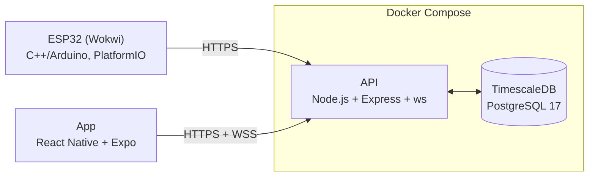

# Relatório Técnico — ECOS

**Projeto:** ECOS — Lembrete Inteligente de Lanche para Estudo em Casa
**Disciplina:** Sistemas Ubíquos — INF/UFG, 2026
**Integrantes:** Ana Liz Bomfim Gomes, Christopher Star Correa de Oliveira, Gustavo Alves Marçal, Mateus Silva de Sousa

Documentos relacionados: [Arquitetura](arquitetura.md) · [Testes](testes.md) · [Instruções de execução](../instrucoes-execucao.md) · [Contrato da API](../contrato/mobile-api.md)

---

## 1. Introdução

Estudantes que passam horas seguidas estudando em casa costumam esquecer de fazer pausas para comer ou beber água. Lembretes fixos no celular são ignorados porque não levam em conta se a pessoa está de fato estudando.

O ECOS é um sistema ubíquo que **percebe a presença do estudante na mesa** e, depois de um período contínuo de estudo, **recomenda uma pausa**. A presença é confirmada por **fusão de dois sensores** (ultrassônico e câmera). O alerta acontece no próprio ambiente (LED e buzzer) e também chega a um **aplicativo móvel**, que guarda o histórico de pausas e permite ligar e desligar o sensor a distância.

## 2. Objetivos

**Geral:** construir um protótipo ponta a ponta de sistema ubíquo, do sensor ao aplicativo, com processamento na borda, comunicação segura e histórico persistente.

**Específicos:**

1. Detectar presença com baixa taxa de falsos positivos, por meio de fusão de sensores.
2. Decidir e atuar localmente, sem depender da internet para o alerta.
3. Transmitir eventos com contrato versionado, autenticação e garantia de não duplicação.
4. Persistir eventos como série temporal e consultá-los por usuário, dispositivo e período.
5. Oferecer um aplicativo com atualizações em tempo real e controle remoto do sensor.
6. Tornar o ambiente reproduzível (Docker) e verificável (testes automatizados e CI).

## 3. Evolução do projeto

| Etapa | Entrega | O que mudou |
|---|---|---|
| **Atividade 01** | [README.md](../README.md) | Problema, usuários, contexto, sensores, fluxo e risco principal (falso positivo de presença) |
| **Atividade 02** | [atividade-02.md](../atividades/atividade-02.md) | Tipos de evento, contrato, validação, janela de estudo, semântica de *event time*, distribuição dispositivo/borda/nuvem e comportamento sob falhas |
| **Marco 02** | [marco-02.md](../marco-02.md) | Primeira fronteira real: ESP32 no Wokwi → HTTPS POST → API Express no Render. Inclusão do sensor de câmera e do contrato **v2** (`sensorConfirmacao`). Simulação de falha de Wi-Fi pelo botão do GPIO 12 |
| **Marco 03** | branch `marco03` | Autenticação por token do dispositivo, validação de certificado no ESP32 e um segundo salto: a API passou a publicar notificações por **WSS** para um consumidor WebSocket autenticado ([`websocket-consumer/`](../consumidor/websocket-consumer)) |
| **Marco 04** | branch `marco04` | Arquitetura atual: **TimescaleDB**, contas de usuário, **app React Native/Expo**, WebSocket para o app, **comandos versionados** para o ESP32, **Docker Compose** e suíte de integração |
| **Documentação e testes** | `docs/` e `.github/` | Este relatório, a documentação de arquitetura, novos testes unitários (API, WebSocket, contratos e app) e integração contínua |

A principal mudança entre o Marco 03 e o Marco 04 foi trocar o **consumidor WebSocket intermediário**, que precisava estar online para a API confirmar o evento, por **persistência no banco antes da confirmação**. Com isso, o ESP32 deixa de depender da disponibilidade de um terceiro serviço, e o histórico passa a ser durável.

## 4. Arquitetura

A arquitetura completa, com diagramas, está em [arquitetura.md](arquitetura.md). Resumo:

| Camada | Tecnologias |
|---|---|
| Dispositivo | Sensor ultrassônico HC-SR04, câmera (sinal digital), LEDs, buzzer |
| Borda | ESP32, Arduino/C++, ArduinoJson, PlatformIO, Wokwi, TLS com CA fixada, NTP |
| Middleware | Node.js 22, Express 5, ws, node-postgres, express-rate-limit |
| Persistência | PostgreSQL 17 + TimescaleDB 2.23 (hypertable de eventos) |
| Aplicativo | React Native 0.88, React 19, Expo SDK 58, TypeScript, SecureStore |
| Infraestrutura | Docker (imagem multi-stage), Docker Compose, cloudflared, GitHub Actions |

## 5. Implementação

### 5.1 Firmware (ESP32)

- Amostra os sensores a cada 500 ms. A presença só é considerada quando **distância < 80 cm E câmera em HIGH**.
- Ao completar 30 s de presença contínua (valor de demonstração, que representa os 50 minutos do cenário real), acende o LED vermelho, toca o buzzer e cria o evento `study.break.required`.
- Envia uma telemetria a cada 15 s, com **backpressure**: não cria nova amostra enquanto a anterior não for persistida.
- Consulta `GET /device/config` a cada 2 s. Ao receber nova versão, zera o timer, aplica o estado (ativado/desativado) e confirma com `sensor.state.reported`.
- Eventos pendentes são reenviados **com o mesmo `eventId`** até serem persistidos.
- Usa HTTPS com **validação de certificado** (CA em `secrets.h`) e sincroniza o relógio por NTP antes do primeiro handshake.

### 5.2 API

- **Dois tipos de credencial**: sessão do usuário (app) e token do dispositivo com `X-Device-Id` (ESP32). Uma não é aceita no lugar da outra.
- **Validação do contrato v2**, com lista de tipos que o sensor pode publicar e descarte de campos extras. O `userId` vem do cadastro do dispositivo.
- **Ingestão transacional e idempotente**: recibo, evento, notificação derivada e atualização do dispositivo são gravados em uma única transação, com lock da linha do dispositivo. A resposta 200 só sai após o COMMIT.
- **Comandos versionados**: cada ativar/desativar incrementa a versão desejada. A confirmação só é aceita para versões existentes, e relatos antigos não regridem o estado.
- **Tempo real**: `pg_notify` dentro da transação; a API repassa `events.changed` apenas ao dono, via WebSocket.
- **Histórico**: paginação por cursor `(time, id)` com precisão de microssegundos e filtros por dispositivo, tipo e período.

### 5.3 Banco de dados

Uma migração ([`001_initial.sql`](../consumidor/migrations/001_initial.sql)) cria as tabelas `users`, `sessions`, `devices`, `commands`, `event_receipts` e a hypertable `events`. As migrações são aplicadas automaticamente quando o contêiner da API sobe, sob um *advisory lock*.

### 5.4 Aplicativo móvel

- Tela de login; a sessão fica no **SecureStore** e é restaurada ao abrir o app.
- Painel com o estado de cada mesa (online/sem conexão, ativado/desativado, comando pendente) e botão para ativar/desativar, com confirmação.
- Histórico de pausas com filtros (mesa; 24 h, 7 dias, 30 dias ou tudo), "puxar para atualizar" e paginação.
- WebSocket com reconexão exponencial e consulta periódica a cada 10 s como reserva. Exibe um alerta "Hora da pausa" quando chega uma pausa nova.

### 5.5 Docker

- [`compose.yaml`](../compose.yaml): serviços `db` (TimescaleDB, volume persistente, porta só em `127.0.0.1`) e `api` (aguarda o banco saudável, migra e inicia; healthcheck em `/health`).
- [`consumidor/Dockerfile`](../consumidor/Dockerfile): estágio `runtime` (dependências de produção, usuário `node`) e estágio `test`.
- [`compose.test.yaml`](../compose.test.yaml): banco descartável em `tmpfs` para a suíte de testes.

## 6. Testes

A estratégia completa, a lista de casos e o roteiro manual estão em [testes.md](testes.md).

| Suíte | Onde | Quantidade |
|---|---|---|
| Domínio/contrato v2 | `consumidor/test/domain.test.js` | 18 |
| Autenticação | `consumidor/test/auth.test.js` | 8 |
| Rotas HTTP | `consumidor/test/app.test.js` | 23 |
| WebSocket | `consumidor/test/realtime.test.js` | 7 |
| Conformidade dos contratos | `consumidor/test/contrato.test.js` | 4 |
| Integração com TimescaleDB | `consumidor/test/integration.test.js` | 14 subtestes |
| Cliente da API do app | `mobile/test/api.test.mjs` | 10 |
| Compilação e tipos | CI: firmware, `tsc`, imagem Docker | 3 verificações |
| Manual (Wokwi + app) | `docs/testes.md` §5 | 12 cenários |

**Resultado local:** 60 testes da API e 10 do app passaram, sem falhas. O typecheck do app passou. A integração com banco real roda no Docker e no GitHub Actions.

Durante a escrita dos testes, foi feito um único ajuste no código de produção: `ApiError` (em `mobile/src/api.ts`) deixou de usar *parameter property* do TypeScript e passou a declarar a propriedade `status` explicitamente. O comportamento é o mesmo, e o módulo pode ser executado diretamente pelo Node nos testes. `validateEvent` também passou a ser exportado por `domain.js` para ser testado isoladamente.

## 7. Dificuldades e soluções

| Dificuldade | Solução adotada |
|---|---|
| Handshake TLS lento ou falhando no Wokwi (erros como `-29312`) | Sincronizar NTP antes do HTTPS, fixar a CA intermediária WE1 como âncora, reutilizar a conexão TLS e aumentar o timeout do handshake para 30 s |
| ESP32 simulado não alcança `localhost` | Túnel HTTPS temporário com `cloudflared` |
| Reenvios após falha de rede duplicavam eventos | `eventId` estável no firmware e tabela `event_receipts` com hash do conteúdo |
| Consumidor WebSocket precisava estar online para confirmar eventos (Marco 03) | Persistir no banco antes de confirmar e usar o WebSocket apenas como aviso |
| Controlar o ESP32 sem expô-lo na internet | Modelo *pull* com estado desejado versionado e confirmação |
| Ambiente diferente em cada máquina do grupo | Docker Compose e `scripts/setup.mjs`, que gera os segredos |

## 8. Limitações e trabalhos futuros

- **Persistência offline no ESP32:** hoje as pendências ficam em RAM. Gravar em flash (NVS/LittleFS) evitaria perder eventos em reinicializações.
- **Notificação push** (Expo Notifications/FCM) para alertar com o app fechado.
- **Câmera real** com detecção embarcada (ex.: ESP32-CAM) no lugar da chave digital simulada.
- **Tolerância a ausências curtas** (2 minutos, conforme a Atividade 02) e janela de 50 minutos configurável pelo app; o firmware atual zera a contagem a cada ausência.
- **Políticas de retenção** e *continuous aggregates* do TimescaleDB para estatísticas de estudo.
- **Testes automatizados de interface** do app e testes unitários do firmware (separando a lógica do hardware).
- **Hospedagem permanente** da API com domínio e certificado próprios, sem túnel temporário.

## 9. Conclusão

O ECOS evoluiu de uma proposta de lembrete local para um sistema ubíquo completo: sensores com fusão na borda, comunicação segura e idempotente, histórico temporal no TimescaleDB, aplicativo móvel em tempo real e controle remoto do dispositivo. As decisões principais foram decidir na borda, persistir antes de confirmar e usar o WebSocket só como aviso. Elas deixaram o sistema tolerante a quedas de rede, reenvios e reinícios da API. O ambiente é reproduzível com Docker, e o comportamento é verificado por testes unitários, de integração e por um roteiro manual, todos executados automaticamente no GitHub Actions.

## Referências

- Espressif. *ESP32 Arduino Core* — https://docs.espressif.com/projects/arduino-esp32/
- Wokwi. *ESP32 Simulator* — https://docs.wokwi.com/
- PlatformIO — https://docs.platformio.org/
- Express 5 — https://expressjs.com/
- ws — https://github.com/websockets/ws
- TimescaleDB — https://docs.timescale.com/
- Expo / React Native — https://docs.expo.dev/ e https://reactnative.dev/
- Docker Compose — https://docs.docker.com/compose/
- Cloudflare Quick Tunnels — https://developers.cloudflare.com/tunnel/get-started/quick-tunnels/
