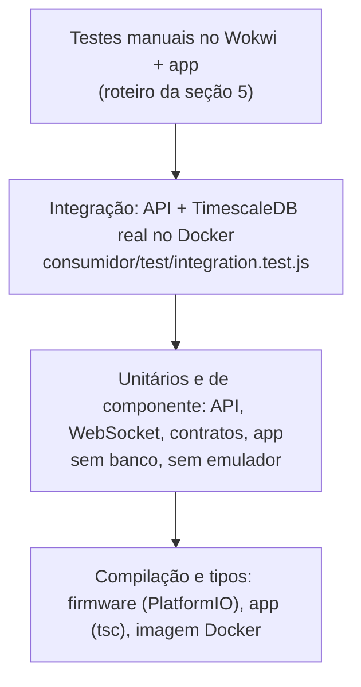

# Testes do ECOS

Este documento descreve a estratégia de testes, como executá-los, o que cada suíte verifica e os resultados obtidos. A arquitetura testada está em [arquitetura.md](arquitetura.md).

---

## 1. Estratégia

Os testes foram organizados em camadas. As camadas de baixo são rápidas e rodam em qualquer máquina; as de cima usam a infraestrutura real (Docker, TimescaleDB, Wokwi).



| Camada | O que garante | Ferramenta | Precisa de |
|---|---|---|---|
| Compilação/tipos | Firmware compila, app não tem erros de tipo, imagem Docker é construída | PlatformIO, `tsc --noEmit`, `docker build` | — |
| Unitários (API) | Regras do contrato, autenticação, rotas, cabeçalhos, erros, consulta de histórico | `node:test` + banco simulado ([`fake-pool.js`](../consumidor/test/helpers/fake-pool.js)) | Node 22+ |
| Componente (WebSocket) | Autenticação do stream, isolamento entre usuários, timeout | `node:test` + `ws` | Node 22+ |
| Contrato | Os exemplos em [`contrato/`](../contrato) continuam válidos para a API | `node:test` | Node 22+ |
| Unitários (app) | Cliente HTTP do app: URL, HTTPS, cabeçalhos, erros | `node:test` com remoção de tipos do Node | Node 22.18+ |
| Integração | Fluxo ponta a ponta com transações, hypertable, concorrência, LISTEN/NOTIFY | `node:test` + Docker Compose | Docker |
| Manual | Sensores, LEDs, buzzer, falha de Wi-Fi e app real | Wokwi + Expo | Wokwi, túnel, celular/emulador |

Todos os testes automatizados usam o executor nativo do Node (`node --test`), então não há dependências extras de teste.

---

## 2. Como executar

### 2.1 API: unitários, WebSocket e contratos (sem Docker)

```bash
cd consumidor
npm ci
npm run test:unit        # unitários + WebSocket + contratos
npm test                 # tudo; a integração é pulada sem TEST_DATABASE_URL
npm run test:coverage    # mesmo conjunto, com relatório de cobertura
```

### 2.2 API: integração com TimescaleDB real (Docker)

Na raiz do repositório:

```bash
docker compose -f compose.test.yaml up --build --abort-on-container-exit --exit-code-from test
docker compose -f compose.test.yaml down -v
```

Isso sobe um TimescaleDB descartável (`ecos_test`, em `tmpfs`) e roda **toda** a suíte da API dentro do estágio `test` da imagem. O teste se recusa a rodar em um banco cujo nome não termine em `_test`.

### 2.3 App React Native

```bash
cd mobile
npm ci
npm test                 # cliente da API (src/api.ts)
npm run typecheck        # TypeScript strict em todo o app
npm run export:check     # opcional: gera o bundle Android para validar o build
```

### 2.4 Firmware ESP32

```bash
cp produtor/secrets.example.h produtor/secrets.h   # se ainda não existir
pio run -d produtor
```

### 2.5 Integração contínua

O workflow [`.github/workflows/testes.yml`](../.github/workflows/testes.yml) roda a cada push e pull request, com quatro jobs:

| Job | Etapas |
|---|---|
| `api-unitarios` | `npm ci` e `npm run test:unit` |
| `api-integracao` | Suíte completa no `compose.test.yaml` e `docker build --target runtime` |
| `mobile` | `npm ci`, `npm test` e `npm run typecheck` |
| `firmware` | `pio run -d produtor` com credenciais de exemplo |

---

## 3. Casos de teste

### 3.1 Domínio e contrato — [`domain.test.js`](../consumidor/test/domain.test.js)

| ID | Caso | Esperado |
|---|---|---|
| DOM-01 | Alerta de pausa válido com campos extras (`userId`, `extra`) | Aceito; campos extras descartados |
| DOM-02 | `schemaVersion` 1 ou `"2"` | 400 |
| DOM-03 | `eventId` ausente, numérico, com espaço, > 100 caracteres ou com injeção SQL | 400 |
| DOM-04 | `deviceId` diferente do dispositivo autenticado | 400 |
| DOM-05 | Corpo nulo | 400 |
| DOM-06 | Sensor publicando `study.break.notification`, `sensor.command.*` ou tipo desconhecido | 403 |
| DOM-07 | Alerta com `state` diferente de `PAUSA_RECOMENDADA` | 400 |
| DOM-08 | Alerta sem confirmação dos dois sensores (`ultrassonico+camera`) | 400 |
| DOM-09 | `sensor.state.reported` válido / com `enabled` texto, `version` negativa ou fracionária | Aceito / 400 |
| DOM-10 | Telemetria válida, inclusive leitura inválida do sensor (`-1`) | Aceita |
| DOM-11 | Telemetria com distância < -1, > 10000, infinita ou texto | 400 |
| DOM-12 | Telemetria com `present` não booleano ou `studySeconds` inválido | 400 |
| DOM-13 | `deviceView` não expõe o hash do token | Sem `token_hash` |
| DOM-14 | `pending` falso quando desejado = relatado; verdadeiro quando diverge ou nunca relatado | Conforme regra |

### 3.2 Autenticação — [`auth.test.js`](../consumidor/test/auth.test.js)

| ID | Caso | Esperado |
|---|---|---|
| AUT-01 | Mesma senha gera hashes diferentes; senha errada é recusada | Salt individual |
| AUT-02 | Formato do hash armazenado | `salt(32 hex):scrypt(128 hex)` |
| AUT-03 | Hash de token | SHA-256 determinístico |
| AUT-04 | Extração do Bearer: válido, minúsculo, ausente, `Basic`, vazio, com espaço | Token ou vazio |
| AUT-05 | `userAuth` com sessão válida | Usuário anexado; só o hash vai ao banco |
| AUT-06 | `userAuth` com sessão inexistente/expirada | 401 |
| AUT-07 | `deviceAuth` sem `X-Device-Id`, com ID errado ou sem token | 401 |

### 3.3 Rotas HTTP — [`app.test.js`](../consumidor/test/app.test.js)

| ID | Caso | Esperado |
|---|---|---|
| API-01 | `GET /health` com banco ok | 200 `{status:"ok"}` |
| API-02 | Cabeçalhos de toda resposta | `Cache-Control: no-store`, sem `X-Powered-By` |
| API-03 | Falha no banco | 500 com mensagem genérica, sem detalhes internos |
| API-04 | `NODE_ENV=production` sem HTTPS | 426 |
| API-05 | Corpo maior que 4 KiB | 413 |
| API-06 | Login correto (e-mail com maiúsculas e espaços) | 200; token de 64 hex; só o hash é persistido |
| API-07 | Senha errada × usuário inexistente | Mesmo 401 e mesma mensagem |
| API-08 | Login com campos ausentes, tipo errado ou e-mail > 254 | 400 |
| API-09 | `GET /me` com/sem sessão | 200 / 401 |
| API-10 | Logout | 204; sessão apagada pelo hash |
| API-11 | 21ª tentativa de login em 15 min | 429 |
| API-12 | Token do sensor em rota do app | 401 |
| API-13 | Sessão do app publicando evento de sensor | 401 |
| API-14 | ESP32 lê `/device/config` | Estado desejado e versão |
| API-15 | ESP32 envia contrato inválido | 400 |
| API-16 | `GET /devices` | Lista do usuário com `pending` |
| API-17 | Comando sem `enabled` booleano ou sem `commandId` UUID | 400 |
| API-18 | `?userId=outro` no histórico | Ignorado; filtra pelo usuário da sessão |
| API-19 | `/breaks` | Restringe a `study.break.notification` |
| API-20 | Filtros `deviceId`, `eventType`, `from`, `to` | Passados como parâmetros SQL, nunca concatenados |
| API-21 | Paginação | `nextCursor` só quando há mais itens; cursor vira comparação `(time,id)` |
| API-22 | `limit` 0/101/texto, datas inválidas, `deviceId` inválido, cursor inválido | 400 |

### 3.4 WebSocket — [`realtime.test.js`](../consumidor/test/realtime.test.js)

| ID | Caso | Esperado |
|---|---|---|
| WS-01 | Inicialização | Executa `LISTEN ecos_events` |
| WS-02 | Conexão em rota diferente de `/api/v1/stream` | Recusada |
| WS-03 | Autenticação com sessão válida | `{type:"ready"}` |
| WS-04 | Token inválido ou de sensor | Fechamento 1008 |
| WS-05 | Primeira mensagem não é JSON de auth | Fechamento 1008 |
| WS-06 | NOTIFY de um evento da Ana | Só a Ana recebe `events.changed`; a Bia não |
| WS-07 | Nenhuma autenticação em 5 s | Fechamento 1008 |

### 3.5 Contratos — [`contrato.test.js`](../consumidor/test/contrato.test.js)

| ID | Caso | Esperado |
|---|---|---|
| CON-01 | [`evento-v2.json`](../contrato/evento-v2.json) | Aceito sem alteração |
| CON-02 | [`evento-v1.json`](../contrato/evento-v1.json) (histórico) | Recusado com 400 |
| CON-03 | Todos os exemplos de evento em [`mobile-api.md`](../contrato/mobile-api.md) | Aceitos |
| CON-04 | [`notificacao-websocket-v1.json`](../contrato/notificacao-websocket-v1.json) | `eventId = notification-<sourceEventId>` |

### 3.6 Integração com TimescaleDB — [`integration.test.js`](../consumidor/test/integration.test.js)

| ID | Caso | Esperado |
|---|---|---|
| INT-01 | Migração executada duas vezes | Idempotente; `events` é hypertable |
| INT-02 | Login e separação de credenciais app × sensor | 401 nos cruzamentos |
| INT-03 | Dispositivos e comandos isolados por dono | Bob não vê nem controla a mesa da Alice (404) |
| INT-04 | Sensor tenta falsificar `deviceId`, tipo ou versão | 400/403/401 |
| INT-05 | Alerta gera evento + notificação; `userId` enviado é ignorado | 2 eventos da Alice |
| INT-06 | 8 envios concorrentes do mesmo `eventId` | 1 gravado, 7 `duplicate:true` |
| INT-07 | Desativação: 202 pendente, repetição idempotente, conflito 409, confirmação do sensor | `pending` → falso; `sensor.command.confirmed` gravado |
| INT-08 | Reativação seguida de relato antigo fora de ordem | Estado mais novo preservado |
| INT-09 | Versões/estados inválidos | 409 sem alterar histórico |
| INT-10 | Paginação completa por cursor | Todos os eventos, sem repetição, com precisão de microssegundos |
| INT-11 | WebSocket após COMMIT | Só o dono é avisado |
| INT-12 | WebSocket com credencial de sensor | 1008 |
| INT-13 | Nova instância da API com outro pool | Recupera histórico, comandos e deduplicação |
| INT-14 | Logout e sessão expirada | 401 |

### 3.7 App — [`mobile/test/api.test.mjs`](../mobile/test/api.test.mjs)

| ID | Caso | Esperado |
|---|---|---|
| APP-01 | `EXPO_PUBLIC_API_URL` com barras finais | Barras removidas |
| APP-02 | URL não configurada | Erro orientando a configurar `mobile/.env`, nenhuma requisição |
| APP-03 | URL `http://` | Aceita só em desenvolvimento (`__DEV__`) |
| APP-04 | `streamUrl` | `https→wss`, `http→ws` |
| APP-05 | GET autenticado | `Authorization: Bearer`, prefixo `/api/v1` |
| APP-06 | POST sem token | Corpo JSON, sem `Authorization` |
| APP-07 | Resposta 204 | Resolve sem ler JSON |
| APP-08 | Erro 401 da API | `ApiError` com status e mensagem do servidor (o app usa isso para encerrar a sessão) |
| APP-09 | Erro sem corpo | Mensagem genérica |
| APP-10 | Timeout | Requisição tem `AbortSignal` |

---

## 4. Resultados

Execução local em 27/11/2026 (Windows 11, Node 26.13):

| Suíte | Testes | Passaram | Falharam | Pulados |
|---|---:|---:|---:|---:|
| API — unitários, WebSocket e contratos (`npm test`) | 61 | 60 | 0 | 1 (integração, sem Docker local) |
| App — cliente da API (`npm test`) | 10 | 10 | 0 | 0 |
| App — `npm run typecheck` | — | ok | — | — |

Execução no GitHub Actions em 27/11/2026 (Ubuntu, Node 22), workflow `Testes`, com os 4 jobs aprovados:

| Job | Resultado |
|---|---|
| API — testes unitários | 60 passaram, 0 falharam |
| API — integração (Docker + TimescaleDB) | 71 passaram, 0 falharam, 4 pulados*; os 14 subtestes de integração passaram; imagem `runtime` construída |
| App React Native — testes e typecheck | 10 passaram; `tsc` sem erros |
| Firmware ESP32 — compilação PlatformIO | Compilado com sucesso |

\* Os 4 pulados são os testes de contrato. A pasta `contrato/` fica fora do contexto da imagem Docker, então esses testes rodam no job de unitários. O resultado de cada execução fica na aba **Actions** do repositório.

**Cobertura das suítes sem banco** (`npm run test:coverage`):

| Arquivo | Linhas | Ramos | Funções |
|---|---:|---:|---:|
| `src/app.js` | 100% | 93,9% | 100% |
| `src/auth.js` | 100% | 100% | 100% |
| `src/realtime.js` | 77,5% | 76,7% | 78,6% |
| `src/domain.js` | 45,0% | 94,6% | 71,4% |
| `src/db.js` | 25,0% | 100% | 0% |

As linhas não cobertas em `domain.js` e `db.js` são as transações de ingestão e de comandos, que dependem do PostgreSQL. Elas são exercitadas pelo teste de integração (INT-05 a INT-13), que roda com banco real.

---

## 5. Roteiro de testes manuais (Wokwi + app)

Pré-requisito: API no Docker, túnel ativo, app logado e simulação iniciada, conforme [instrucoes-execucao.md](../instrucoes-execucao.md).

| ID | Passos | Resultado esperado |
|---|---|---|
| MAN-01 | Iniciar a simulação | Serial: Wi-Fi conectado, NTP sincronizado, `CONFIGURACAO APLICADA` |
| MAN-02 | Ativar sensor no app; distância 50 cm; chave da câmera em HIGH | LED verde aceso; tempo de estudo aumenta |
| MAN-03 | Manter presença por 30 s | LED vermelho, bipe, `PAUSA_RECOMENDADA`, `Evento persistido: HTTP 200`; alerta "Hora da pausa" no app e item no histórico |
| MAN-04 | Chave da câmera em LOW com distância 50 cm | Ausência: tempo zera, LEDs apagam (fusão de sensores) |
| MAN-05 | Distância 150 cm com câmera em HIGH | Ausência (fusão de sensores) |
| MAN-06 | Desativar no app | App mostra "pendente" e depois "Sensor desativado"; ESP32 para de ler e não gera pausas |
| MAN-07 | Segurar **Falha Wi-Fi** e enviar um comando pelo app | Comando fica pendente no app |
| MAN-08 | Soltar o botão | ESP32 reconecta, aplica e confirma; pendência some |
| MAN-09 | Gerar pausa com **Falha Wi-Fi** pressionado; depois soltar | Alerta local imediato; evento enviado ao reconectar com o mesmo `eventId` |
| MAN-10 | Reiniciar a simulação | ESP32 recupera o último estado desejado salvo na API |
| MAN-11 | Fechar e reabrir o app | Sessão restaurada do SecureStore |
| MAN-12 | Logout | Volta à tela de login; token anterior não funciona mais |

---

## 6. Limitações dos testes

- O firmware é verificado por compilação e pelo roteiro manual; não há testes unitários automatizados da lógica em C++ (ela está acoplada às funções de hardware do Arduino).
- Os componentes visuais do app (`App.tsx`) são verificados pelo `typecheck` e pelo roteiro manual; não há testes automatizados de interface.
- A suíte de integração precisa de Docker. Sem ele, `npm test` a pula e informa isso na saída.
