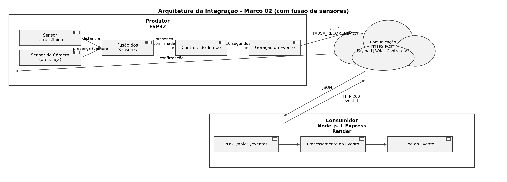

# Marco 02 — Integração entre Componentes

## 1. Objetivo

O objetivo deste marco é implementar e validar uma fronteira real de comunicação entre dois componentes do projeto.

A integração implementada possui três elementos principais:

**ESP32 → HTTPS POST → API Node.js/Express**

- **Produtor:** ESP32 simulado no Wokwi.
- **Comunicação:** requisição HTTPS utilizando o método POST e payload JSON.
- **Consumidor:** API desenvolvida em Node.js com Express e hospedada no Render.

O ESP32 utiliza dois sensores para detectar a presença do estudante — um sensor ultrassônico e um sensor de câmera — e controla o tempo de estudo. A presença só é confirmada quando os dois sensores concordam (fusão de sensores). Após 10 segundos de presença confirmada, o produtor gera um evento indicando que uma pausa é recomendada.

Esse evento é enviado para o componente consumidor, que recebe os dados e registra o evento em seu log.

### Arquivos

- [Código do componente produtor](produtor/sketch.ino)
- [Código do componente consumidor](consumidor/server.js)
- [Contrato do evento (versão 2)](contrato/evento-v2.json)
- [Configurações da integração](configuracoes.md)
- [Instruções de execução](instrucoes-execucao.md)

---

## 2. Arquitetura da Integração

A arquitetura implementada no Marco 02 estabelece a comunicação entre o componente produtor e o componente consumidor.



*(O [diagrama anterior](diagrama-marco-02.png), sem o sensor de câmera, permanece no repositório como histórico.)*

O ESP32 atua como produtor. O sensor ultrassônico e o sensor de câmera detectam a presença do estudante de forma independente, e a fusão desses dois sensores confirma a presença antes de o evento `PAUSA_RECOMENDADA` ser gerado. A comunicação é realizada através de uma requisição HTTPS POST com payload JSON.

A API Node.js/Express atua como consumidor, recebe o evento, registra as informações no log e retorna uma resposta HTTP 200 ao produtor.

---

## 3. Contrato da Comunicação

A comunicação utiliza um payload JSON com estrutura definida e versão identificada pelo campo `schemaVersion`.

[Contrato do evento - versão 2](contrato/evento-v2.json) (a [versão 1](contrato/evento-v1.json) permanece no repositório como histórico, anterior à inclusão do segundo sensor)

Exemplo:

```json
{
  "schemaVersion": 2,
  "eventId": "evt-1",
  "deviceId": "esp32-mesa-01",
  "eventType": "study.break.required",
  "state": "PAUSA_RECOMENDADA",
  "sensorConfirmacao": "ultrassonico+camera"
}
```

### Campos

| Campo | Função |
|---|---|
| `schemaVersion` | Identifica a versão do contrato |
| `eventId` | Identifica o evento |
| `deviceId` | Identifica o dispositivo produtor |
| `eventType` | Informa o tipo do evento |
| `state` | Informa o estado gerado pelo produtor |
| `sensorConfirmacao` | Informa quais sensores confirmaram a presença que originou o evento (adicionado na versão 2, junto com o sensor de câmera) |

A versão utilizada atualmente é `schemaVersion: 2`.

Cada evento gerado possui um identificador no campo `eventId`.

Exemplo:

```text
eventId: evt-1
```

Esse identificador permite acompanhar o mesmo evento desde sua geração no produtor até sua confirmação pelo consumidor.

---

## 4. Demonstração — Fluxo Normal

### Passo 1 — Iniciar o consumidor

O consumidor está disponível através do Render.

Endpoint:

```text
POST https://ecos-ecmd.onrender.com/api/v1/eventos
```

Também pode ser executado localmente:

```bash
cd consumidor
npm install
npm start
```

Resultado esperado:

```text
Consumidor executando na porta 3000
Aguardando eventos...
```

### Passo 2 — Executar o produtor

O ESP32 é executado através do PlatformIO e do Wokwi Simulator.

Após realizar o Build no PlatformIO, iniciar a simulação no Wokwi.

Com o estudante presente e confirmado pelos dois sensores, o monitor serial apresenta:

```text
Wi-Fi conectado.
Ultrassonico: PRESENCA | Camera: PRESENCA
PRESENTE | Tempo: 0s
Ultrassonico: PRESENCA | Camera: PRESENCA
PRESENTE | Tempo: 1s
...
Ultrassonico: PRESENCA | Camera: PRESENCA
PRESENTE | Tempo: 10s
```

### Passo 3 — Geração do evento

Ao atingir 10 segundos de presença confirmada pelos dois sensores, o produtor gera o evento:

```text
PAUSA_RECOMENDADA

=== EVENTO GERADO ===
{"schemaVersion":2,"eventId":"evt-1","deviceId":"esp32-mesa-01","eventType":"study.break.required","state":"PAUSA_RECOMENDADA","sensorConfirmacao":"ultrassonico+camera"}
```

Nesse momento, o evento foi criado pelo produtor e possui um identificador próprio.

### Passo 4 — Comunicação

O produtor envia o evento utilizando:

```text
HTTPS POST
Content-Type: application/json
```

O destino é:

```text
https://ecos-ecmd.onrender.com/api/v1/eventos
```

Resultado esperado no produtor:

```text
Enviando evento para o consumidor...
SUCESSO - HTTP 200
{"status":"recebido","eventId":"evt-1"}
```

---

## 5. Efeito no Consumidor

O efeito utilizado para comprovar a integração é o registro do evento recebido no log do consumidor.

Após o envio, o consumidor apresenta:

```text
=== EVENTO RECEBIDO ===
ID: evt-1
Dispositivo: esp32-mesa-01
Tipo: study.break.required
Estado: PAUSA_RECOMENDADA
Confirmação de sensores: ultrassonico+camera
=======================
```

O mesmo `eventId` gerado pelo produtor aparece no consumidor e também na resposta enviada ao ESP32:

```json
{
  "status": "recebido",
  "eventId": "evt-1"
}
```

O código HTTP `200` confirma que a requisição foi recebida e processada pelo consumidor.

---

## 6. Condição de Falha

A condição de falha escolhida para a integração é a **indisponibilidade da comunicação Wi-Fi do componente produtor**.

A falha ocorre na fronteira de comunicação entre o ESP32 e o consumidor Node.js/Express.

Para tornar essa condição reproduzível durante a demonstração, o botão conectado ao GPIO 12 é utilizado para simular a indisponibilidade da comunicação.

### Demonstração da Falha

Iniciar novamente a simulação e manter o botão conectado ao GPIO 12 pressionado antes do evento ser gerado.

Ao atingir 10 segundos, o evento é criado normalmente:

```text
PAUSA_RECOMENDADA

=== EVENTO GERADO ===
{"schemaVersion":2,"eventId":"evt-1","deviceId":"esp32-mesa-01","eventType":"study.break.required","state":"PAUSA_RECOMENDADA","sensorConfirmacao":"ultrassonico+camera"}
```

Como a condição de falha está ativa, o produtor interrompe sua conexão Wi-Fi:

```text
FALHA SIMULADA: comunicacao Wi-Fi indisponivel.
FALHA DETECTADA: produtor sem conexao Wi-Fi.
Evento aguardando recuperacao da comunicacao...
```

Enquanto o botão permanecer pressionado, o produtor não realiza o envio e o consumidor não recebe o evento.

### Recuperação

Ao liberar o botão, a condição de falha é encerrada e o produtor tenta recuperar sua conexão:

```text
Falha encerrada.
Tentando recuperar a conexao Wi-Fi...
.
Wi-Fi reconectado.
Enviando evento para o consumidor...
SUCESSO - HTTP 200
{"status":"recebido","eventId":"evt-1"}
```

Após a recuperação da comunicação, o mesmo evento que estava aguardando é enviado ao consumidor.

A implementação realiza uma **recuperação da conectividade antes do envio**. Não é realizado um segundo POST após uma primeira tentativa HTTP falhar.

---

## 7. Principais Decisões Arquiteturais

### 7.1 Separação entre produtor e consumidor

A solução foi dividida em dois componentes com responsabilidades distintas.

O **produtor**, implementado no ESP32, é responsável por detectar a presença do estudante, controlar o tempo de estudo, gerar o evento e iniciar sua transmissão.

O **consumidor**, implementado em Node.js com Express, é responsável por disponibilizar o endpoint, receber o evento, processar seu conteúdo, registrar as informações e retornar uma resposta ao produtor.

- [Código do componente produtor](produtor/sketch.ino)
- [Código do componente consumidor](consumidor/server.js)

### 7.2 Comunicação HTTPS

Foi utilizado o modelo de comunicação baseado em requisição e resposta através de HTTPS, utilizando o método POST.

O fluxo adotado é:

```text
ESP32 → HTTPS POST → API Node.js/Express → HTTP 200
```

Essa abordagem permite que o produtor envie o evento ao consumidor e receba uma resposta confirmando o processamento da requisição.

### 7.3 Payload JSON e contrato versionado

Foi escolhido o formato JSON para representar os dados trocados entre os componentes.

A estrutura da comunicação é definida por um contrato versionado através do campo `schemaVersion`.

A versão utilizada no Marco 02, após a inclusão do sensor de câmera, é:

```text
schemaVersion: 2
```

Isso permite que produtor e consumidor compartilhem uma estrutura previamente definida para a troca de dados.

[Contrato do evento - versão 2](contrato/evento-v2.json) (a [versão 1](contrato/evento-v1.json) permanece como histórico)

### 7.4 Identificação dos eventos

Cada evento gerado possui um `eventId`, utilizado para acompanhar o evento durante a comunicação entre produtor e consumidor.

Durante a demonstração, o mesmo identificador pode ser observado:

```text
Produtor → eventId → Consumidor → Resposta
```

Isso permite relacionar o evento gerado com seu recebimento pelo consumidor.

### 7.5 Tratamento da indisponibilidade

Foi considerada a possibilidade de o produtor estar sem conectividade no momento em que um evento é gerado.

Nessa situação, o evento permanece aguardando em memória enquanto a condição de falha estiver ativa.

Após a recuperação da conexão Wi-Fi, o produtor realiza o envio do mesmo evento.

No protótipo, essa condição é reproduzida através do botão conectado ao GPIO 12.

### 7.6 Fusão de sensores (sensor ultrassônico + sensor de câmera)

Foi adicionado um segundo sensor ao produtor: um sensor de câmera, responsável por detectar a presença de uma pessoa de forma independente do sensor ultrassônico já existente.

A presença do estudante passou a ser confirmada apenas quando os dois sensores concordam simultaneamente, em vez de depender da leitura de um único sensor.

Essa decisão reduz a chance de falsos positivos: uma leitura isolada e ruidosa de um dos sensores não é suficiente, isoladamente, para iniciar a contagem do tempo de estudo.

Essa mudança motivou a evolução do contrato do evento para a versão 2, que passou a incluir o campo `sensorConfirmacao`, registrando quais sensores confirmaram a presença que originou o evento.

- [Código do componente produtor](produtor/sketch.ino)
- [Contrato do evento - versão 2](contrato/evento-v2.json)